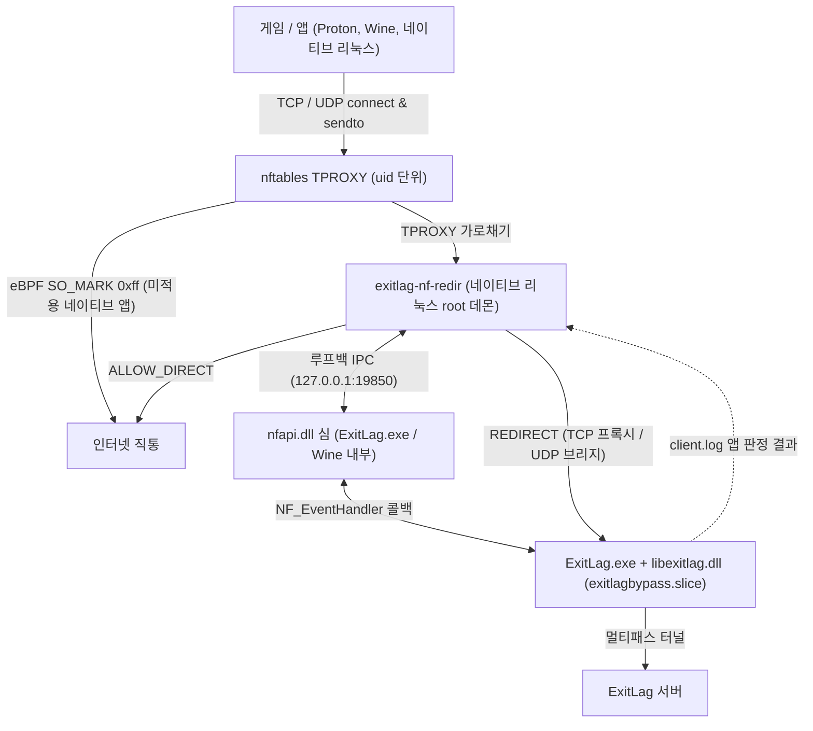

# exitlag_linux

> [English](README.md) | **한국어**

공식 Windows용 **ExitLag** 클라이언트를 리눅스(Wine)에서 그대로 실행하고, 윈도우와 동일하게 ExitLag GUI에서 켠 게임/앱의 TCP·UDP 트래픽만 선택적으로 라우팅하는 호환 레이어입니다.

> [!NOTE]
> 비공식 호환 레이어 프로젝트이며 ExitLag와 무관합니다.
> ExitLag 바이너리는 포함하지 않으며, 공식 설치 파일과 본인 ExitLag 계정/구독이 필요합니다.

---

## 동작 원리

윈도우의 ExitLag는 커널 드라이버(NetFilter SDK `nfextlag.sys`)로 아웃바운드 연결을 가로채 프로세스별로 터널링 여부를 판정합니다. 리눅스에는 해당 드라이버가 없으므로 **nftables TPROXY + eBPF + 드롭인 `nfapi.dll` 심**으로 대체합니다.



### 핵심 구성요소

| 구성요소 | 경로 | 역할 |
|---|---|---|
| `nfapi.dll` 심 | `shim/src/nfapi_shim.cpp` | 원본 NFSDK v8 DLL을 대체해 루프백 IPC로 연결/패킷을 중계하고 Wine 호환 훅 제공 |
| `nfextlag` 서비스 | `shim/src/nfextlag_svc.cpp` | ExitLag 시작 시 확인하는 `nfextlag` 서비스 상태를 `SERVICE_RUNNING`으로 응답 |
| TPROXY 리다이렉터 | `shim/linux/exitlag_nf_redir.cpp` | TCP/UDP를 가로채고 Wine/Proton `wineserver` 소켓을 실제 `.exe` 이름으로 매핑해 중계 |
| eBPF 직통 우회 | `shim/linux/exitlag_direct.bpf.c` | `cgroup/sock_create` 훅으로 미적용 네이티브 앱 소켓에 `SO_MARK 0xff` 표시 |
| 네트워크 규칙 | `shim/linux/exitlag-nf-net.sh` | `nftables` TPROXY 체인 및 정책 라우팅 테이블(`100`) 설치·제거 |
| root 감독 스크립트 | `shim/linux/exitlag-nf-root.sh` | `pkexec`/`sudo`로 리다이렉터를 실행하고 종료 시 방화벽 규칙 정리 보장 |

### 프로세스별 라우팅 (`--scope uid`, 기본값)

- **Wine / Proton 게임**: 모든 연결을 ExitLag가 판정합니다. `wineserver`가 들고 있는 소켓도 같은 `WINEPREFIX` / `STEAM_COMPAT_DATA_PATH` 안의 실제 Windows `.exe` 프로세스로 자동 매핑되며, Wine/Proton 런타임은 절대 eBPF 우회되지 않습니다.
- **네이티브 리눅스 앱** (브라우저, Discord, Steam 등): 첫 소켓에서 ExitLag가 `<no-app>`으로 판정하면 해당 PID를 eBPF `direct_pids` 맵에 등록해 커널 레벨로 바로 직통 처리합니다. 15초마다 재검사하므로 ExitLag에서 앱을 새로 켜면 재시작 없이 자동 적용됩니다.
- **루프 방지**: ExitLag 본체와 전용 Wine prefix는 `exitlagbypass.slice`에서 실행되고, 리다이렉터의 외부 소켓은 `SO_MARK 0xff`를 사용합니다.
- **선택 옵션 `--scope cgroup`**: `shim/exitlag-game.sh <명령>`으로 실행한 프로세스(`exitlag.slice`)만 가로챕니다.

### Wine 호환 처리 (`nfapi.dll` 심)

- **WMI 복구 대화상자 자동 응답**: Wine에 `Win32_LogicalDiskRootDirectory`가 없어 시작 시 숨은 창으로 0%에서 멈추는 WMI 복구 질문에 자동으로 `No`를 반환합니다.
- **비동기 ICMP 크래시 회피**: Wine 11.22 `iphlpapi.dll`의 비동기 `0x30`바이트 힙 이중 해제를 피하기 위해 `IcmpSendEcho2Ex` / `Icmp6SendEcho2`를 동기 워커 풀로 직렬화합니다.
- **`GetExtendedTcpTable` 훅**: ExitLag의 5초 주기 좀비 연결 정리기가 TPROXY 연결을 강제 종료하지 않도록 활성 브리지 TCP 소켓을 테이블에 노출합니다.
- **소프트웨어 OpenGL RHI**: DirectComposition 및 DRI2/EGL 멈춤을 피하기 위해 ExitLag 동봉 `opengl32sw.dll`(`QSG_RHI_BACKEND=opengl`, `QT_OPENGL=software`, `QSG_RENDER_LOOP=basic`)로 GUI를 렌더링합니다.

---

## 요구사항

- **OS / 커널**: x86_64 리눅스, cgroup v2, `nftables`, `TPROXY`, `CONFIG_CGROUP_BPF`, polkit 에이전트(또는 `sudo`)
- **Wine**: Wine 11.x (테스트 환경: Arch Linux, Wine 11.22, 커널 7.3)
- **빌드 도구**: `clang`, `clang-cl`, `lld-link`, `g++`, `libbpf` 헤더, `pkg-config`, `innoextract`
- **MSVC CRT/SDK**: `_tools/xwin`에 설치된 [`xwin`](https://github.com/Jake-Shadle/xwin)
- **ExitLag**: 공식 Windows Inno Setup 설치 파일(`.exe`)과 ExitLag 계정

---

## 빠른 시작

```bash
git clone https://github.com/kyulio/exitlag_linux.git
cd exitlag_linux

# 1. MSVC CRT/SDK 헤더 및 라이브러리 설치 (최초 1회)
cargo install xwin
xwin --accept-license splat --output _tools/xwin

# 2. ExitLag 추출, 심/리다이렉터/eBPF 빌드, Wine prefix 준비
shim/setup.sh /path/to/ExitLag-installer.exe
```

`shim/setup.sh`는 이미 완료된 단계를 자동으로 건너뛰므로 다시 실행해도 안전합니다.
1. `innoextract`로 설치 파일을 `extracted/app/`에 추출합니다.
2. 원본 `nfapi.dll`을 `extracted/app/nfapi.dll.orig`로 백업합니다.
3. `nfapi.dll`, `nfextlag_svc.exe`, `exitlag-nf-redir`, `exitlag_direct.bpf.o`를 빌드합니다.
4. `_tools/wineprefix`를 초기화하고 `nfextlag` 서비스를 등록합니다.

---

## 사용법

```bash
shim/run_exitlag.sh --verbose
```

1. polkit 창에 비밀번호를 입력합니다(`nftables` TPROXY 규칙과 리다이렉터 실행에 root 권한 필요).
2. ExitLag가 열리면 로그인합니다(Google 로그인은 기본 리눅스 브라우저로 열립니다).
3. ExitLag에서 게임/앱을 켜고 서버를 선택한 뒤 게임을 실행합니다.
4. 종료할 때는 터미널에서 `Ctrl+C`를 누르거나 ExitLag를 닫으면 TPROXY 규칙이 자동으로 정리됩니다.

### 실행 옵션

| 옵션 | 설명 |
|---|---|
| `--verbose` | `shim/state/exitlag_nf_redir.log`에 연결별 상세 로그 출력 |
| `--scope uid\|cgroup` | 유저 전체 프로세스 감시(기본 `uid`) 또는 `exitlag-game.sh`만 감시(`cgroup`) |
| `--no-tproxy` | 네트워크 가로채기 없이 ExitLag GUI만 실행 |
| `--restore-nfapi` | `nfapi.dll.orig`에서 원본 `extracted/app/nfapi.dll` 복원 |

---

## Proton 게임 참고

- 대부분의 **Proton / Wine** 게임은 ExitLag에서 켜기만 하면 별도 설정 없이 작동합니다.
- **MapleStory Global (Steam AppID `216150`)**:
  - **GE-Proton11-3 이상** 권장(실행 직후 `0xc0000005` 크래시 수정 포함).
  - 평소에는 `PROTON_LOG=1` 같은 디버그 옵션을 끄세요(넥슨 안티치트 종료 원인).
  - 계정 등록 국가 제한은 VPN으로 우회되지 않습니다.
- 리눅스/Proton에서 커널 안티치트로 원래 실행이 막히는 게임은 ExitLag과 무관하게 지원되지 않습니다.

---

## 문제 해결

| 증상 | 해결 방법 |
|---|---|
| 비정상 종료 후 인터넷이 안 됨 | `sudo shim/linux/exitlag-nf-net.sh down`으로 남은 TPROXY 규칙 제거 |
| 로그인 후 GUI가 0%에서 멈춤 | `nfapi.dll` 동기화 확인(`run_exitlag.sh`가 자동 동기화) 및 `shim/state/nfapi_shim.log`의 `auto-answered WMI` 확인 |
| 게임 트래픽이 터널을 안 탐 | `shim/state/exitlag_nf_redir.log`의 `REDIRECT` / `pin ... -> ExitLag app` 및 `extracted/app/client.log`의 `-> proxify` 확인 |

### 로그 파일

- `shim/state/exitlag_nf_redir.log` — TPROXY 리다이렉터, 프로세스 매핑, eBPF 우회/고정 기록
- `shim/state/nfapi_shim.log` — `nfapi.dll` IPC 및 Wine 호환 훅 로그
- `extracted/app/client.log` — ExitLag 자체의 연결별 `proxify` / `pass` 판정 로그

---

## 저장소 구성

```text
shim/
├── setup.sh                      # 최초 1회 설치 (추출, 빌드, Wine prefix)
├── run_exitlag.sh                # 메인 실행 스크립트 (cgroup 우회, TPROXY, GUI)
├── build_nf.sh                   # nfapi.dll 및 nfextlag_svc.exe 크로스 컴파일
├── exitlag-game.sh               # --scope cgroup용 선택 실행 래퍼
├── src/
│   ├── nfapi_shim.cpp            # 드롭인 NFSDK v8 심 + Wine 호환 훅
│   ├── nfapi_shim.def            # nfapi.dll MSVC 익스포트 정의
│   ├── nf_bridge_proto.hpp       # Windows <-> Linux 공유 IPC 프로토콜
│   └── nfextlag_svc.cpp          # 더미 nfextlag Win32 서비스
└── linux/
    ├── build.sh                  # exitlag-nf-redir 및 eBPF 빌드
    ├── exitlag_nf_redir.cpp      # 네이티브 리눅스 TPROXY TCP/UDP 리다이렉터
    ├── exitlag_direct.bpf.c      # eBPF cgroup/sock_create 직통 우회 훅
    ├── exitlag-nf-net.sh         # nftables TPROXY + 정책 라우팅 설치/제거
    ├── exitlag-nf-root.sh        # 방화벽 자동 정리를 보장하는 root 감독 스크립트
    └── test_nf_tproxy_netns.sh   # rootless unshare -Urn 종단간 TPROXY 테스트
```

커밋 제외(`.gitignore`): `shim/state/`, `extracted/`, `_tools/`, `shim/build/`.

---

## 라이선스

[GNU General Public License v3.0](LICENSE) 라이선스를 따릅니다 (`shim/linux/exitlag_direct.bpf.c`는 `GPL-2.0-or-later`).
