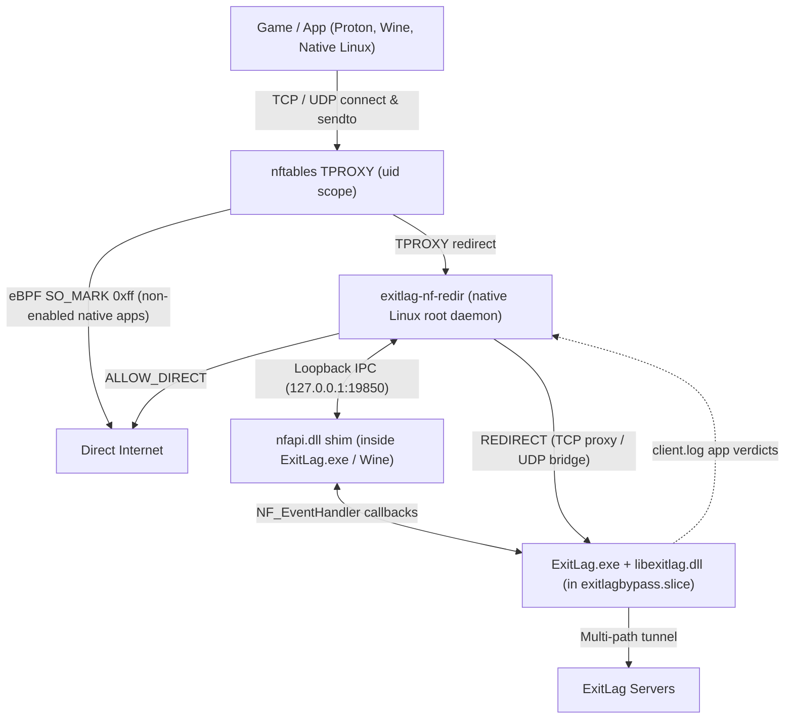

# exitlag_linux

> **English** | [한국어](README.ko.md)

Run the official Windows **ExitLag** client natively on Linux (via Wine) with per-process TCP/UDP routing — toggle any game or app in the ExitLag GUI and only its traffic is routed through ExitLag, just like on Windows.

> [!NOTE]
> Unofficial compatibility layer, not affiliated with ExitLag.
> No ExitLag binaries are included — you must provide the official installer and your own ExitLag account/subscription.

---

## How It Works

On Windows, ExitLag uses a kernel driver (NetFilter SDK `nfextlag.sys`) to intercept outbound connections and decide per process whether to tunnel or pass them through. On Linux, `exitlag_linux` replaces that kernel driver with **nftables TPROXY + eBPF + a drop-in `nfapi.dll` shim**:



### Core Components

| Component | Path | Role |
|---|---|---|
| `nfapi.dll` shim | `shim/src/nfapi_shim.cpp` | Drop-in NFSDK v8 replacement bridging callbacks over loopback IPC, plus Wine compatibility hooks |
| `nfextlag` service | `shim/src/nfextlag_svc.cpp` | Minimal Win32 service reporting `SERVICE_RUNNING` for ExitLag's driver check |
| TPROXY redirector | `shim/linux/exitlag_nf_redir.cpp` | Intercepts TCP/UDP, attributes Wine/Proton `wineserver` sockets to real `.exe` names, and proxies traffic |
| eBPF fast-path | `shim/linux/exitlag_direct.bpf.c` | `cgroup/sock_create` hook marking bypassed native Linux PIDs with `SO_MARK 0xff` |
| Network rules | `shim/linux/exitlag-nf-net.sh` | Installs and tears down `nftables` TPROXY chains and policy routing table `100` |
| Root supervisor | `shim/linux/exitlag-nf-root.sh` | Runs `exitlag-nf-redir` via `pkexec`/`sudo` and guarantees firewall cleanup on exit |

### Per-Process Routing (`--scope uid`, default)

- **Wine / Proton games**: Every connection is evaluated by ExitLag. Sockets held by `wineserver` are automatically attributed to the real Windows `.exe` inside the same `WINEPREFIX` / `STEAM_COMPAT_DATA_PATH`, and Wine/Proton runtime processes are never eBPF-bypassed.
- **Native Linux apps** (browsers, Discord, Steam, etc.): Evaluated on their first socket. If ExitLag reports `<no-app>`, the PID is added to the eBPF `direct_pids` map so future sockets bypass TPROXY at kernel speed. Bypassed PIDs are re-probed every 15 seconds so newly enabled apps take effect automatically.
- **Loop prevention**: ExitLag and its Wine prefix run inside `exitlagbypass.slice`, and outbound redirector sockets use `SO_MARK 0xff`.
- **Optional `--scope cgroup`**: Only intercept processes explicitly launched via `shim/exitlag-game.sh <command>` (`exitlag.slice`).

### Wine Compatibility Fixes (`nfapi.dll` shim)

- **WMI repair dialog**: Auto-answers ExitLag's startup WMI repair prompt with `No` (Wine lacks `Win32_LogicalDiskRootDirectory`, which otherwise stalls startup at 0%).
- **Async ICMP crash workaround**: Serializes async `IcmpSendEcho2Ex` / `Icmp6SendEcho2` calls onto a bounded worker pool using Wine's synchronous path, avoiding a `0x30`-byte heap double-free in Wine 11.22 `iphlpapi.dll`.
- **`GetExtendedTcpTable` hook**: Exposes active TPROXY-bridged TCP sockets to ExitLag's 5-second zombie-connection sweeper so active game/launcher connections are not dropped.
- **Software OpenGL RHI**: Launches Qt/QML with ExitLag's bundled `opengl32sw.dll` (`QSG_RHI_BACKEND=opengl`, `QT_OPENGL=software`, `QSG_RENDER_LOOP=basic`) to avoid DirectComposition and DRI2/EGL freezes.

---

## Requirements

- **OS / Kernel**: x86_64 Linux with cgroup v2, `nftables`, `TPROXY`, `CONFIG_CGROUP_BPF`, and a polkit agent (or `sudo`)
- **Wine**: Wine 11.x (tested on Arch Linux, Wine 11.22, kernel 7.3)
- **Build tools**: `clang`, `clang-cl`, `lld-link`, `g++`, `libbpf` headers, `pkg-config`, `innoextract`
- **MSVC CRT/SDK**: [`xwin`](https://github.com/Jake-Shadle/xwin) installed into `_tools/xwin`
- **ExitLag**: Official Windows Inno Setup installer (`.exe`) and an ExitLag account

---

## Quick Start

```bash
git clone https://github.com/kyulio/exitlag_linux.git
cd exitlag_linux

# 1. Fetch MSVC CRT/SDK headers and libraries (one-time)
cargo install xwin
xwin --accept-license splat --output _tools/xwin

# 2. Extract ExitLag, build shims/redirector/eBPF, and prepare Wine prefix
shim/setup.sh /path/to/ExitLag-installer.exe
```

`shim/setup.sh` is idempotent and safe to re-run. It:
1. Extracts the installer into `extracted/app/` with `innoextract`.
2. Backs up the original `nfapi.dll` to `extracted/app/nfapi.dll.orig`.
3. Builds `nfapi.dll`, `nfextlag_svc.exe`, `exitlag-nf-redir`, and `exitlag_direct.bpf.o`.
4. Initializes `_tools/wineprefix` and registers the `nfextlag` service.

---

## Usage

```bash
shim/run_exitlag.sh --verbose
```

1. Authenticate in the polkit prompt (root is required for `nftables` TPROXY rules and `exitlag-nf-redir`).
2. Sign in to ExitLag (Google OAuth opens in your default Linux browser).
3. Enable your game/app and select a server in ExitLag, then launch the game.
4. Press `Ctrl+C` in the terminal (or close ExitLag) to cleanly tear down TPROXY rules and exit.

### Options

| Flag | Description |
|---|---|
| `--verbose` | Enable verbose redirector logging in `shim/state/exitlag_nf_redir.log` |
| `--scope uid\|cgroup` | Route all user processes via ExitLag rules (default `uid`) or only `exitlag-game.sh` (`cgroup`) |
| `--no-tproxy` | Launch the ExitLag GUI only without configuring network interception |
| `--restore-nfapi` | Restore `extracted/app/nfapi.dll` from `nfapi.dll.orig` |

---

## Proton Notes

- Most **Proton / Wine** games work out of the box once enabled in ExitLag.
- **MapleStory Global (Steam AppID `216150`)**:
  - Use **GE-Proton11-3 or newer** (fixes a startup `0xc0000005` crash).
  - Keep `PROTON_LOG=1` disabled during normal play (Nexon anti-cheat can exit under debug logging).
  - Account-level region locks cannot be bypassed by any VPN/proxy.
- Games blocked by kernel-level anti-cheat on Linux/Proton remain unsupported regardless of ExitLag.

---

## Troubleshooting

| Issue | Resolution |
|---|---|
| No internet after an abnormal crash | Run `sudo shim/linux/exitlag-nf-net.sh down` to clear leftover TPROXY rules |
| ExitLag GUI freezes at 0% after login | Verify `nfapi.dll` is synced (`run_exitlag.sh` syncs it automatically) and check `shim/state/nfapi_shim.log` for `auto-answered WMI` |
| Game traffic is not routed | Check `shim/state/exitlag_nf_redir.log` for `REDIRECT` / `pin ... -> ExitLag app` and `extracted/app/client.log` for `-> proxify` |

### Logs

- `shim/state/exitlag_nf_redir.log` — TPROXY redirector, process attribution, and eBPF bypass/pin events
- `shim/state/nfapi_shim.log` — `nfapi.dll` IPC and Wine compatibility hooks
- `extracted/app/client.log` — ExitLag's own per-connection `proxify` / `pass` decisions

---

## Repository Layout

```text
shim/
├── setup.sh                      # One-time setup (extract, build, Wine prefix)
├── run_exitlag.sh                # Main launcher (cgroup bypass, TPROXY, ExitLag GUI)
├── build_nf.sh                   # Cross-compile nfapi.dll & nfextlag_svc.exe
├── exitlag-game.sh               # Optional cgroup launcher for --scope cgroup
├── src/
│   ├── nfapi_shim.cpp            # Drop-in NFSDK v8 shim + Wine hooks
│   ├── nfapi_shim.def            # MSVC mangled exports for nfapi.dll
│   ├── nf_bridge_proto.hpp       # Shared Windows <-> Linux IPC protocol
│   └── nfextlag_svc.cpp          # Dummy nfextlag Win32 service
└── linux/
    ├── build.sh                  # Build exitlag-nf-redir & eBPF object
    ├── exitlag_nf_redir.cpp      # Native Linux TPROXY TCP/UDP redirector
    ├── exitlag_direct.bpf.c      # eBPF cgroup/sock_create direct-bypass hook
    ├── exitlag-nf-net.sh         # nftables TPROXY + policy routing setup/teardown
    ├── exitlag-nf-root.sh        # Root supervisor with guaranteed cleanup
    └── test_nf_tproxy_netns.sh   # Rootless unshare -Urn end-to-end TPROXY test
```

Ignored runtime/build paths (`.gitignore`): `shim/state/`, `extracted/`, `_tools/`, `shim/build/`.

---

## License

Licensed under the [GNU General Public License v3.0](LICENSE) (`shim/linux/exitlag_direct.bpf.c` is `GPL-2.0-or-later`).
